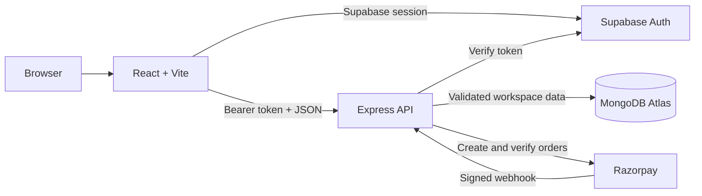

# Fairshare

A complete expense-sharing application built with **MongoDB, Express, React, and Node**, with Supabase authentication and Razorpay checkout.

**Live application:** [fairshare.tinkeringspaces.com](https://fairshare.tinkeringspaces.com)
**Demo video:** [watch the product walkthrough](docs/demo/fairshare-demo.mp4)

## Problem statement

Shared trips, flats, meals, and projects create a repeated coordination problem: one person pays, several people owe different amounts, payments happen outside the app, and the group loses track of the current balance. Spreadsheets and chat messages preserve fragments of the story but do not maintain a reliable ledger.

## Target users

- Friends sharing travel and social expenses.
- Flatmates managing rent, utilities, groceries, and household purchases.
- Small teams splitting meals or event costs.
- Couples and families who want a shared record without accounting complexity.

## Solution

Fair Share keeps groups, expenses, exact split rules, comments, settlements, and simplified debts in one authenticated workspace. Money is stored in integer minor units, balances are calculated separately per currency, and every saved payment immediately updates what each person owes. The product explains the result in plain language so a new user can create a group and record the first expense without training.

## Core workflows

1. **Create a group:** add people by name immediately and attach email addresses only when invitations are needed.
2. **Record an expense:** select the payer, participants, currency, category, date, and an equal, exact, percentage, or weighted-share split.
3. **Understand balances:** inspect group ledgers, search and filter expenses, and use simplified debts to see the minimum useful payment directions.
4. **Settle up:** record an external UPI, bank, cash, or other payment and recalculate the ledger without moving money inside Fair Share.
5. **Invite and analyze:** create an email-bound workspace invitation, view Plus spending insights, or export CSV data with an active entitlement.

## Engineering highlights

- Supabase sessions are verified again by the Express API; browser user IDs are never trusted directly.
- MongoDB stores workspaces, memberships, invitations, purchases, and time-limited entitlements.
- Zod validates bounded workspace payloads and cross-record references before persistence.
- Versioned writes provide optimistic concurrency protection and return HTTP 409 on conflicts.
- Split calculations use paise/cents and largest-remainder rounding, keeping totals exact.
- Razorpay orders, checkout signatures, captured payment details, and signed webhooks are verified server-side.
- Helmet, CORS restrictions, rate limiting, payload limits, spreadsheet-injection-safe CSV output, and environment-only secrets protect exposed surfaces.

## Technology stack

| Layer | Technology | Responsibility |
| --- | --- | --- |
| Frontend | React 19, Vite | Responsive UI, forms, filtering, local drafts, optimistic interaction states |
| API | Node.js, Express 5 | Authenticated routes, validation, persistence, invitations, billing |
| Database | MongoDB Atlas, Mongoose | Shared workspace and billing records |
| Authentication | Supabase Auth | Google OAuth and email/password identity |
| Payments | Razorpay | Fixed 30-day Plus passes |
| Validation | Zod | Input bounds and ledger integrity |
| Hosting | Vercel | Static frontend and serverless Express API on one origin |
| Testing | Node test runner | Splits, balances, settlements, parsing, search, and duplicate detection |

## Architecture



The frontend and API are served from the same production origin. Protected API requests include a Supabase bearer token; Express verifies it with Supabase before resolving the user's MongoDB membership. See [the architecture document](docs/ARCHITECTURE.md) for the data model, request flow, and trade-offs.

## Run locally

Requires Node 20.19+ (Node 22+ recommended), npm, a MongoDB database, a Supabase project, and a Razorpay account for payments.

```sh
npm install
cp .env.example .env
npm run dev
```

Open **http://localhost:5180/** for Fairshare. Fairshare uses port 5180 with strict port checking, so it will fail clearly if that port is occupied instead of silently switching addresses. Port 5173 may belong to a different app. The landing page is public; the expense workspace requires a Supabase account.

To enable real accounts, configure `.env` and start the Express API in another terminal:

```sh
npm run server
```

Vite serves Fairshare at `http://localhost:5180/` and proxies `/api` to port 4000. Restart Vite after changing any `VITE_` environment variable.

## Environment variables

| Variable | Purpose |
| --- | --- |
| `MONGODB_URI` | MongoDB connection string; server only |
| `SUPABASE_URL` | Supabase project URL; server |
| `SUPABASE_ANON_KEY` | Supabase publishable/anon key; server |
| `VITE_SUPABASE_URL` | Same project URL, exposed to browser |
| `VITE_SUPABASE_ANON_KEY` | Same publishable/anon key, exposed to browser |
| `CLIENT_ORIGIN` | Exact frontend origin(s), comma separated, for CORS |
| `PORT` | Express port; defaults to 4000 |
| `VITE_API_URL` | Express origin in production; empty for Vite proxy or same-origin deployment |
| `RAZORPAY_KEY_ID` | Razorpay key ID; server returns the public key ID to checkout |
| `RAZORPAY_KEY_SECRET` | Razorpay secret; server only |
| `RAZORPAY_WEBHOOK_SECRET` | Secret set on the Razorpay webhook; server only |

Never prefix database credentials or payment secrets with `VITE_`. Never commit `.env`.

## What works

- Dashboard with balances, recent expenses, friend summaries, and spending categories.
- Groups with member selection; group detail, membership edits, and simplified debts within each group.
- People/contact records with optional email addresses. Names are enough to start splitting; add email later when inviting someone.
- Expenses with equal, exact, percentage, and weighted-share splits; paid-by selection, participant selection, dates, categories, notes, editing, deletion, and comments.
- Split values use integer minor units and largest-remainder rounding. Totals remain exact.
- Settlement recording and recalculated balances. Settlement recording does **not** transfer money.
- Search, category filters, recent-date filters, and four separate currency ledgers (INR, USD, EUR, GBP). No exchange conversion is performed.
- Supabase Google OAuth and email/password signup, login, logout, email confirmation support, password reset, and verified backend sessions.
- Shared workspace invitations. The owner adds a contact with an email, opens their details, and generates an email-bound invitation link valid for seven days. The recipient signs in with that email. Links are not emailed automatically.
- Plus category insights, spending summaries, and CSV export. Demo Plus preview is explicitly separate from a paid entitlement.
- Razorpay order creation, Standard Checkout, server signature verification, payment capture verification, and signed webhook handling.


## Revised experience

The original Fairshare two-bar logo and soft card-based overview are restored. Groups use one neutral visual treatment, with no trip, home, or friends category to choose during setup. The dashboard combines groups and recent expenses with settlement and spending panels. Quick entry remains available in an expandable section. Group membership and payment directions use plain language.

- **Quick entry:** type `Lunch 1200` or `Dinner INR 1,200.50`, choose a group, and save an equal split directly. The preview shows the total and your share. Select the full form for a custom payer or split. The default category is Food & drinks; change it in the full form when appropriate.
- **First-time setup:** create a group and add names inline, without email or accounts. The first-group flow continues into the expense form.
- **Simpler expense form:** description, amount, currency, and group first. Payer, participants, exact/percentage/share splits, date, category, and notes are available under Change split / More options.
- **Drafts:** unfinished new expenses are stored on this device, separately for each local workspace or signed-in account. Reopen the form or use Resume draft. Discard draft removes it. Editing an existing expense does not overwrite the new-expense draft.
- **Duplicate warning:** matching description, amount, payer, currency, group, and date triggers a warning before another expense is saved. You can explicitly confirm a separate expense.
- **Repeat expense:** copies details and original split into a new expense dated today; it does not automatically schedule expenses.
- **Undo deletion:** an immediate Undo deletion action restores the last deleted expense while its notification is visible. Undo is in memory; it does not survive reloads or workspace switches. Payment deletion is not provided.
- **Reminder text:** Copy reminder copies a suggested message for you to send. Fairshare does not send messages automatically.
- **Find expenses:** search description, payer, group, notes, and category. Filter by group, category, or date; sort newest, oldest, or largest.
- **Keyboard:** `N` opens the expense form; `Cmd/Ctrl K` opens expense search; `Escape` closes a dialog. Input fields do not trigger single-key shortcuts.
- **Data safety:** sample and personal local workspaces are stored separately. Signing in loads the cloud workspace without silently importing local sample or personal data. Copy/import of a local workspace into a cloud account is not implemented.

### Performance choices

Ledger rows are bucketed by group in one pass and balances are memoized until state or currency changes. Currency formatters are cached, searches use React deferred values, and expense lists render in batches of 20. Forms are loaded on demand. The icon-library dependency and external font request have been removed. These changes reduce avoidable work; no benchmark against competing products is claimed. Cloud writes still use the existing whole-workspace API with a version conflict check; database pagination is future work.

### Browser verification

Verified the names-only first-group flow, automatic transition to the first expense, saved-draft restoration, exact ₹100.01 split across three people, duplicate warning, repeat-form split preservation, delete and immediate undo, and restored balances. Live MongoDB/Supabase/Razorpay integration still requires your credentials.

## Product and pricing decision

Core expense sharing stays free: no daily expense limits or group limits in the UI. Plus is proposed at **₹149 for a 30-day pass**. It includes personal spending summaries, category breakdowns, and CSV exports. It is a fixed pass, **not a recurring subscription**; it does not auto-renew. The server owns the price and entitlement. A client callback alone cannot grant Plus. The export API checks entitlement on the server.

Future premium candidates: receipt OCR/itemization, recurring-expense automation, budget alerts, and historical FX conversion. These need external services or scheduled jobs and are not represented as working features in this build.

## Configure Supabase

1. Create a Supabase project and enable email/password authentication.
2. Add your frontend origin to Auth → URL Configuration → Site URL and allowed redirect URLs. Include the frontend root and its `?reset=1` password recovery route as permitted by your redirect configuration.
3. Put the URL and publishable/anon key in both the server and frontend variables listed above. No service-role key is needed.
4. For Google sign-in, create a Google Web OAuth client, register `https://irehequxgozvpqrkqzel.supabase.co/auth/v1/callback` as an authorized redirect URI, then enable Google under Auth → Sign In / Providers with its client ID and secret.
5. Restart both processes. Sign in from the landing page. New accounts start with an empty workspace.

The Express middleware verifies bearer tokens using `supabase.auth.getUser(token)`, rather than trusting browser user IDs. All state is loaded through authenticated membership lookups.

## Configure Razorpay

1. Begin with Razorpay test credentials and enable automatic capture for this integration.
2. Add the key ID and secret to the server environment.
3. Create a webhook at `https://YOUR_API_ORIGIN/api/billing/webhook`, subscribe to `payment.captured`, and configure `RAZORPAY_WEBHOOK_SECRET`.
4. Test captured, failed, dismissed, duplicate, and delayed payments before switching to live credentials.

The server binds each order to the authenticated user, verifies the HMAC against the stored order ID, fetches the payment to confirm `captured` status, amount, order, and currency, then grants a fixed expiration. Webhooks use the raw request body. Duplicate deliveries do not extend the pass. Expiration is 30 days from order creation; abandoned orders grant nothing. When capture has not completed, the signed webhook can grant access later; refresh or sign in again to reload entitlement.

## Workspace model and constraints

This first implementation supports **one shared workspace per account**. Every invited workspace member can view and edit every group, expense, contact, and comment in that workspace. The workspace owner alone creates invitations. Invitations are not group-scoped. Existing accounts with another workspace cannot join a different workspace; migration/multiple-workspace selection is not implemented.

Contact IDs are ledger identities and are matched to signed-in users by verified email when an email is supplied. Name-only contacts use an empty email and cannot receive invitation links until a valid email is added. A person's email can be used in multiple groups. Contacts do not have to create accounts to be included in expenses.

The API validates ledger structure, membership references, unique record IDs, amounts, totals, and currency codes. State writes use an optimistic version check: conflicts return HTTP 409 and require refreshing. There is no automatic live polling or conflict merge. Bound document limits keep the initial whole-workspace API manageable; a production app should move large ledgers to paginated collections.

This is an independently branded functional foundation, not a complete reproduction of every Splitwise feature. Not implemented: receipt uploads/scanning, recurring jobs, email delivery, push notifications, bank/UPI transfers, FX conversion, account deletion, multiple workspaces, immutable audit history, moderation, payment refunds/revocation, and subscriptions. Members can edit each other's ledger entries; review roles and permissions before broader deployment.

## Build and deploy

```sh
npm test
npm run build
```

`dist/` contains the React frontend. Production is a full-stack Vercel deployment: the static React build and the Express API run on the same origin, with `api/index.js` deployed as a Vercel serverless function and `/api/*` rewritten to it by `vercel.json`. `VITE_API_URL` stays empty for this setup. The production API is available at `https://fairshare.tinkeringspaces.com/api/health`. For a separate frontend host, configure `VITE_API_URL`, set `CLIENT_ORIGIN` on the server, and allow the frontend URL in Supabase.

The API can start without MongoDB credentials for a health check, but account routes return 503 until both MongoDB and Supabase are configured. Missing payment credentials return 503 from checkout. There is no insecure server-side demo bypass.

## Validation

`npm test` runs 10 tests covering largest-remainder rounding, invalid splits, settlement effects, zero-sum ledgers, currency separation, quick-entry parsing, duplicate detection, summary calculation, and search. `npm run build` validates the React bundle. MongoDB and Supabase are configured in production. Razorpay checkout still requires its three server-side credentials before live payment testing.

## Reference documentation

- [Supabase verified user lookup](https://supabase.com/docs/reference/javascript/auth-getuser)
- [Razorpay Standard Checkout](https://razorpay.com/docs/payments/payment-gateway/web-integration/standard/integration-steps/)
